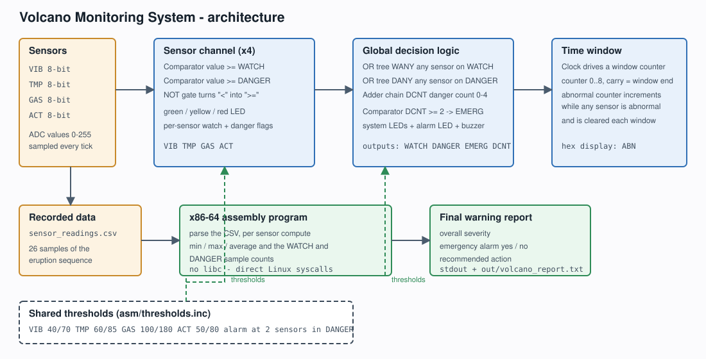

# Volcano Monitoring System - Project Report

**Group 7**

| # | Name | Roll No. |
|---|---|---|
| 1 | Kartik Jayant | B25CM1027 |
| 2 | Amisha Nainwani | B25CM1074 |
| 3 | Tanushree Chandankhede | B25CM1056 |
| 4 | Archi Gupta | B25CM1007 |
| 5 | Kanhaiya Panjiyar | B25CM1026 |
| 6 | Rama Charan | B25CM1030 |

---

## 1. Abstract

Volcanic eruptions are preceded by measurable changes in the ground, in the
temperature and in the gas content of the air. This project builds a simplified
volcano monitoring and early-warning system that watches four such signals and
turns them into an actionable warning.

The system is implemented in two independent but consistent halves. A **digital
circuit** designed in Logisim-Evolution implements the monitoring logic in
hardware: it compares every live sensor reading against a warning threshold and
a danger threshold, shows the state of each sensor on LEDs, counts abnormal
readings inside a sliding time window, and raises an emergency alarm when two
or more sensors are simultaneously in the danger state. An **x86-64 assembly
program** performs the same classification offline on a recorded sequence of
readings and writes a final warning report containing the minimum, maximum and
average of every sensor, the number of abnormal samples, the overall severity
and the recommended action.

Both halves are driven by one shared threshold table, and both are verified
against an independent third implementation written in Python. The circuit passes
all 18 test vectors and the assembly report matches the reference model exactly
on both recorded datasets.

---

## 2. Introduction and problem statement

A monitoring station for a volcano must answer two questions continuously:

1. *Right now, how serious is the situation?* - this is a combinational question
   about the current sample and is naturally answered by hardware.
2. *Over the whole recording, what happened, and what should we do?* - this is a
   question about a sequence of samples and needs an offline analysis.

The assignment asks for exactly this pair: a Logisim circuit with comparators,
LEDs, warning levels and counters, plus an x86-64 assembly program that analyses
a sequence of recorded measurements and produces a final warning report.

### Objective

Design a working monitoring system that

* takes four 8-bit digital sensor inputs (ground vibration, temperature, gas
  concentration, volcanic activity);
* classifies each reading into **NORMAL**, **WATCH** or **DANGER** using fixed
  thresholds;
* displays the status of every sensor on LEDs and shows the overall system
  status;
* counts abnormal readings inside a specified time interval;
* raises an emergency alarm when multiple sensors indicate dangerous activity;
* analyses a recorded sequence offline and generates a final warning report
  containing the minimum, maximum and average of each sensor and the severity of
  the detected activity.

---

## 3. Warning model

| Level | Condition | LED |
|---|---|---|
| NORMAL | `value < WATCH` | green |
| WATCH | `WATCH <= value < DANGER` | yellow |
| DANGER | `value >= DANGER` | red |

| Sensor | Symbol | Unit | WATCH | DANGER |
|---|---|---|---|---|
| Ground vibration | `VIB` | index 0-255 | 40 | 70 |
| Temperature | `TMP` | degC | 60 | 85 |
| Gas concentration | `GAS` | ppm | 100 | 180 |
| Volcanic activity | `ACT` | index 0-255 | 50 | 80 |


The emergency alarm is raised when **two or more** sensors are in the DANGER
state at the same time, which is the assignment's "multiple sensor conditions
indicate potentially dangerous volcanic activity".


These twelve numbers live in exactly one place, `asm/thresholds.inc`. The
Logisim circuit, the assembly program and the Python reference model all read
them, so the three implementations cannot drift apart.

---

## 4. System design



### 4.1 Hardware - the Logisim circuit

`circuit/volcano_monitor.circ` contains 173 components and 176 wire segments in
one flat schematic. The design is organised in four horizontal channel bands and
a global block beneath them.

**Sensor channel (one per sensor, 4 in total).**

Each channel performs two threshold comparisons and drives three LEDs.

The key detail is how "greater than or equal" is obtained. Logisim's
**Comparator** offers three outputs, `>`, `=` and `<`, but no `>=` output.
Rather than compare against `threshold - 1` (which would put misleading numbers
such as 39 in the schematic), the circuit uses

```
value >= threshold   <=>   NOT (value < threshold)
```

so the `<` output of the comparator is inverted by a **NOT gate**. The constants
in the schematic are therefore exactly the thresholds from the table above.

Each channel produces two one-bit flags, `watch` and `danger`. Because the danger
threshold is always greater than the watch threshold, `danger` implies `watch`,
and the two flags form a complete two-bit severity code:

| watch | danger | level |
|---|---|---|
| 0 | 0 | NORMAL |
| 0 | 1 | DANGER |
| 1 | 0 | WATCH |

The three LEDs follow directly:

```
green  = NOT watch
yellow = watch AND NOT danger
red    = danger
```

**Global block.**

* Two **OR trees** (two levels of two-input OR gates) reduce the four watch
  flags to `WANY` and the four danger flags to `DANY`.
* An **adder chain** sums the four danger flags into a four-bit count `DCNT`
  (0 to 4). Each single-bit flag is first widened to four bits by a
  **Bit Extender**, because the Adder component only accepts equal-width buses.
  The result is shown on a **hex digit display**.
* A third **Comparator** tests `DCNT >= 2`. Its output drives the orange
  **emergency alarm LED** and the **buzzer**.
* Three more LEDs show the system-wide status (green NORMAL, yellow WATCH,
  red DANGER).

**Time window counters.**

* A **Clock** drives a window counter (`CNT_WINDOW`) that counts 0 to 8. Its
  `carry` output is high for exactly one tick per window, so it is a clean
  end-of-window pulse.
* A second counter (`CNT_ABNORMAL`) increments on every tick in which at least
  one sensor is abnormal, and is cleared by the end-of-window pulse. It is
  enabled by `WANY`, so it counts precisely the abnormal readings inside the
  current window.
* Both counters are displayed on hex digit displays.

**Readability.** Long connections are made with **tunnels** rather than cables.
A tunnel is a labelled net point; two tunnels with the same label are the same
net. The net names are systematic: `SVIB`, `WVIB`, `DVIB` for the vibration
channel, `WANY`, `DANY`, `DCNT`, `ABN`, `WINC`, `WEND`, `CLK`, `EMERG` for the
global signals.

**Output pins.** Five output pins (`OUT_WATCH`, `OUT_DANGER`, `OUT_EMERG`,
`OUT_DCNT`, `OUT_ABN`) expose the results so that the circuit can be driven by
an automated test bench.

### 4.2 Software - the x86-64 assembly program

`asm/volcano_report.asm` is a freestanding Linux program written for NASM. It
uses no C library; it talks to the kernel directly through `syscall`.

```
_start
  |-- read the CSV file            open(2) -> read(0) -> close(3)
  |-- reset the statistics
  |-- skip the header line
  |-- parse loop                   read 4 numbers per row, update the stats
  |-- build the report             append text into a 16 KB buffer
  |-- write it out                 write(1) to stdout and to the report file
  `-- exit(60)
```

**Data layout.** Each sensor owns a 64-byte block in `.bss`:

| Offset | Contents |
|---|---|
| +0 | minimum reading |
| +8 | maximum reading |
| +16 | sum of all readings |
| +24 | number of samples |
| +32 | number of samples on WATCH |
| +40 | number of samples on DANGER |

**Parsing.** The file is read into a 64 KB buffer in one `read` call. A cursor
register walks through the buffer; `parse_number` converts a run of ASCII digits
into an integer with the usual `value = value * 10 + digit` loop, and
`skip_separator` steps over the commas.

**Statistics.** For every row, each of the four readings is folded into its
sensor's block: the minimum and maximum are compared and updated, the sum and
the sample count are incremented, and the two threshold counters are raised when
the reading reaches the watch or the danger threshold. The thresholds are
fetched from a table that is generated from the same `%define` values as the
header file.

**Reporting.** The report is composed in a 16 KB buffer with three helpers -
`emit_str` appends a zero-terminated string, `emit_number` converts an integer
to decimal by repeatedly dividing by ten and taking the remainder, and
`emit_average` prints a value with one decimal place (integer part plus
`(remainder * 10) / count`). The finished buffer is written to standard output
and saved to `out/volcano_report.txt`.

**Severity rule.** Every sensor is judged by the worst reading it ever produced;
the overall status is the highest of the four per-sensor levels, and the alarm is
raised when at least two sensors reached the danger level.

---

## 5. Implementation

### 5.1 Files

| File | Purpose |
|---|---|
| `circuit/volcano_monitor.circ` | the digital circuit |
| `circuit/volcano_monitor_vectors.txt` | 18 test vectors, generated from the thresholds |
| `asm/volcano_report.asm` | the assembly program |
| `asm/thresholds.inc` | the shared threshold table |
| `data/sensor_readings.csv` | 26 recorded samples of an eruption sequence |
| `data/sensor_readings_quiet.csv` | 5 recorded samples of a quiet period |
| `tools/gen_vectors.py` | the Python reference model and the vector generator |
| `tools/check_circuit_widths.py` | checks that every net in the saved circuit carries one bus width |
| `tools/build_volcano_circ.py` | generates the circuit through the Logisim MCP server |
| `tools/cross_check.py` | compares the program's report with the reference model |
| `tools/check_all.sh` | runs the whole verification suite |

### 5.2 Building the circuit

The circuit was produced with the **Logisim MCP server** (`afishyke/Logisim-Evolution-MCP-Server`),
which exposes tools such as `logisim_create_project`, `logisim_apply_batch`,
`logisim_validate_project`, `logisim_test_vector` and `logisim_launch_gui`. The
generator script `tools/build_volcano_circ.py` emits the component and wire
arrays and the MCP server applies them to a new project, validating every write
against Logisim itself. A geometry self-check in `tools/circbuild.py` verifies
before writing that no wire ends in mid-air, that no wire crosses a component
body and that no two components overlap.

### 5.3 Building and running the program

```bash
nasm -f elf64 -I asm/ asm/volcano_report.asm -o out/volcano_report.o
ld -o out/volcano_report out/volcano_report.o
./out/volcano_report data/sensor_readings.csv
```

A `Makefile` wraps this, and `make check` runs the complete verification suite.

---

## 6. Results

### 6.1 Circuit test vectors

The circuit was exercised with 18 vectors covering quiet conditions, each
threshold boundary, single and multiple danger conditions and full saturation.
The expected results are produced by the Python reference model, not written by
hand.

```
Loading test vector "volcano_monitor_vectors.txt"
Running 18 vectors
Passed: 18, Failed: 0
```

### 6.2 Assembly report on the recorded eruption

```
VOLCANO MONITORING SYSTEM - FINAL WARNING REPORT
--------------------------------------------------------------
Recorded samples analysed : 26

Ground vibration: index (0-255)
  minimum = 12   maximum = 130   average = 79.8
  samples on WATCH  = 20   samples on DANGER = 17
  final severity = DANGER

Temperature: degC
  minimum = 28   maximum = 108   average = 74.2
  samples on WATCH  = 18   samples on DANGER = 13
  final severity = DANGER

Gas concentration: ppm
  minimum = 25   maximum = 230   average = 148.8
  samples on WATCH  = 18   samples on DANGER = 13
  final severity = DANGER

Volcanic activity: index (0-255)
  minimum = 8   maximum = 124   average = 73.4
  samples on WATCH  = 18   samples on DANGER = 14
  final severity = DANGER

--------------------------------------------------------------
Warning thresholds
Ground vibration:   WATCH  >= 40   DANGER >= 70
Temperature:   WATCH  >= 60   DANGER >= 85
Gas concentration:   WATCH  >= 100   DANGER >= 180
Volcanic activity:   WATCH  >= 50   DANGER >= 80
--------------------------------------------------------------
OVERALL STATUS  : DANGER
Sensors at DANGER: 4
Samples on WATCH or worse: 74
EMERGENCY ALARM : RAISED
ACTION          : Evacuate the exclusion zone. Volcanic activity is dangerous.
--------------------------------------------------------------
```

The recorded data is a clear escalation: the first six samples are quiet, the
activity begins in the seventh sample and every sensor reaches the danger level
by the fourteenth sample. The program correctly reports four sensors in danger
and raises the alarm.

### 6.3 Assembly report on a quiet recording

Running the same program on `data/sensor_readings_quiet.csv` produces
`OVERALL STATUS : NORMAL` and `EMERGENCY ALARM : not raised`, which confirms
that the thresholds are not simply always triggered.

### 6.4 Circuit bus-width check

Logisim reports a conflict between differently sized buses as
*"Incompatible widths (n)"*. `tools/check_circuit_widths.py` reproduces that
check directly on the saved `.circ` file, so the defect it guards against -
tying a Counter's 4-bit `data` port to a 1-bit Ground - cannot come back:

```
volcano_monitor.circ: 173 components, 176 wires, 153 nets
  OK: every net carries a single bus width
```

### 6.5 Verification summary

```
==============================================================
 1/3  Logisim test vectors
==============================================================
Passed: 18, Failed: 0
PASS: Logisim circuit matches every test vector

==============================================================
 1b/3  Circuit bus-width check (Logisim "Incompatible widths")
==============================================================
volcano_monitor.circ: 173 components, 176 wires, 153 nets
  OK: every net carries a single bus width
PASS: no bus-width conflict in the saved circuit

==============================================================
 2/3  Assembly program output
==============================================================
PASS: the program ran on both datasets

==============================================================
 3/3  Assembly output vs the python reference model
==============================================================
PASS  data/sensor_readings.csv  (26 samples, overall=DANGER, alarm=yes)
PASS  data/sensor_readings_quiet.csv  (5 samples, overall=NORMAL, alarm=no)

ALL CHECKS PASSED
```

---

## 7. Learning outcomes

* How a digital comparator, a NOT gate, an adder chain and a counter combine
  into a complete monitoring circuit, and why a "greater or equal" test is built
  from a "less than" output.
* How nets are labelled with tunnels so that a large schematic stays readable.
* How a freestanding x86-64 Linux program works: the `syscall` convention, the
  `open / read / write / close` sequence, and how to convert text to integers
  and integers to text without a library.
* How to keep a hardware design and a software design consistent by giving them
  one shared source of truth for the thresholds.
* How to test a circuit automatically with test vectors, and how to test an
  assembly program by comparing it against an independent model.

---

## 8. Conclusion

The project delivers both halves of the assignment and, more importantly, makes
them agree. The Logisim circuit implements the live monitoring logic with
comparators, LED status displays, a warning-level encoder, a windowed abnormal
counter and an emergency alarm, and it passes every test vector. The x86-64
assembly program analyses a recorded sequence, computes the minimum, maximum and
average of each sensor, counts the abnormal samples, and prints a final warning
report whose severity and alarm state match an independent reference model.

The design is easy to extend: a new sensor means one more channel, one more
pair of thresholds and one more entry in the statistics block, and both the
circuit and the program pick the change up from the same header file.

---

## 9. References

1. Logisim-Evolution documentation - <https://logisim-evolution.github.io/>
2. Logisim-Evolution source, `com.cburch.logisim` (component geometry and
   counter behaviour) - <https://github.com/logisim-evolution/logisim-evolution>
3. `afishyke/Logisim-Evolution-MCP-Server` - MCP server used to build and
   validate the circuit - <https://github.com/afishyke/Logisim-Evolution-MCP-Server>
4. NASM manual, the x86-64 instruction set and the `syscall` convention
5. The Linux `syscall(2)` manual page
